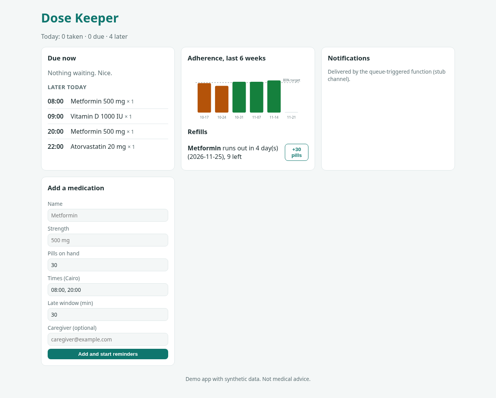
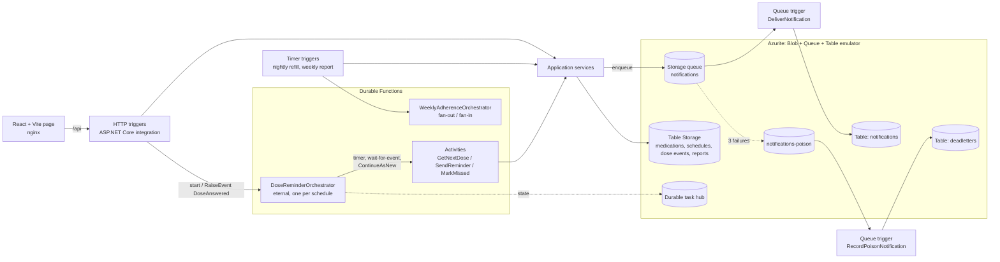

# Dose Keeper

Medication schedules, dose check-ins, refill forecasts and **escalating reminders**, built **serverless** on
Azure Functions (.NET 10 isolated worker) with **Durable Functions** — and runnable 100% locally for free with
Azurite and the official Functions host image.

> Demo project with synthetic data. **Not medical advice** and not a medical device; never rely on it for real treatment.



## What it does

- Medications with a pill count; schedules with times of day, weekdays, start/end dates and a time zone
  (default `Africa/Cairo`, DST-aware — Egypt has used summer time again since 2023).
- At each dose time a reminder fires. No answer by half the late window → a second reminder. No answer by the end →
  the dose is marked **missed** and an optional caregiver is alerted. Take/Skip from the web page stops the escalation.
- Taking a dose draws stock; a nightly timer forecasts "refill in N days" and queues a notice below the threshold.
- Weekly adherence % (taken ÷ due, late doses flagged) as a chart, plus an on-demand fan-out/fan-in weekly report.

## Architecture



Layers (enforced by `tests/DoseKeeper.ArchitectureTests`):

| Project | Role |
| --- | --- |
| `DoseKeeper.Domain` | Pure C#: `Medication`, `DoseSchedule` (expansion to UTC with the zone's rules), `DoseEvent`, `RefillForecast`, `Adherence`. No packages. |
| `DoseKeeper.Application` | Use cases + ports (`IMedicationRepository`, `INotificationOutbox`, …). `TimeProvider` injected. |
| `DoseKeeper.Infrastructure` | Azure Table Storage repositories, Storage Queue outbox. |
| `DoseKeeper.Functions` | Composition root: HTTP, queue, timer triggers, orchestrators, activities. |
| `src/Web` | React 19 + TypeScript page, polls every 10 s. |

## Quickstart

Requirements: Docker (or rootless Podman with the docker CLI), .NET SDK 10, Node 22.

```bash
docker compose up -d --build --wait      # azurite + functions host + web
curl -X POST localhost:8080/api/demo/seed # optional: 3 synthetic medications with 6 weeks of history
open http://localhost:8080               # web page (API at http://localhost:7071/api)
scripts/smoke.sh                         # end-to-end check, ~2 minutes (needs az CLI for the poison step)
docker compose down -v
```

Tests and checks:

```bash
dotnet build DoseKeeper.slnx -warnaserror
dotnet test DoseKeeper.slnx              # unit + orchestrator + Testcontainers Azurite + architecture tests
cd src/Web && npm ci && npm run lint && npm run build && npm test
az bicep build --file infra/main.bicep   # compile only; nothing is deployed
```

Without Docker for the host: install Azure Functions Core Tools v4, run `azurite` and
`func start` in `src/DoseKeeper.Functions` (`local.settings.json` points at `UseDevelopmentStorage=true`).

### API

| Method | Route | Notes |
| --- | --- | --- |
| GET | `/api/health` | storage reachable |
| POST/GET | `/api/medications` | create / list |
| POST | `/api/medications/{id}/refill` | `{ "pills": 30 }` |
| POST/GET | `/api/schedules` | create starts `reminders-{id}` orchestration |
| GET | `/api/schedules/{id}/reminders` | Durable runtime + custom status |
| GET | `/api/doses/today` | expanded doses with status |
| POST | `/api/doses/take`, `/api/doses/skip` | `{ scheduleId, dueUtc }`, raises `DoseAnswered` |
| GET | `/api/notifications` | delivered notifications (stub channel) |
| GET | `/api/deadletters` | messages parked from the poison queue |
| POST | `/api/demo/seed` | synthetic demo data; 404 unless `DoseKeeper__EnableDemoSeed=true` |
| GET | `/api/refills`, POST `/api/refills/check` | forecast / run the nightly check now |
| GET | `/api/adherence?weeks=6` | chart data |
| POST | `/api/reports/weekly`, GET `/api/reports/weekly/{id}`, GET `/api/reports/latest` | fan-out/fan-in report |

## Design notes (talking points)

- **Human-interaction pattern**: `WaitForExternalEvent` raced with a durable timer via `Task.WhenAny`, cancel the
  loser. Two-stage escalation, then `MarkMissed` + caregiver alert. Stale answers for other doses are ignored.
- **Eternal orchestration**: `ContinueAsNew` after every dose keeps history tiny; the instance id is deterministic
  per schedule, so creating it is idempotent. Bounded loops satisfy the Durable analyzers (DURABLE0011).
- **Determinism bug found in the live run**: `CancellationTokenSource.CancelAsync()` resumed the orchestrator on the
  thread pool and the "answered" path silently stalled; synchronous `Cancel()` fixed it. Unit tests with a mocked
  `TaskOrchestrationContext` (NSubstitute) cover answered / escalate → missed / pre-answered / stale / ended.
- **Fan-out/fan-in**: weekly report runs one activity per schedule in parallel, then one save activity.
- **Queue trigger + poison handling**: `maxDequeueCount: 3` in `host.json`; a poison-queue trigger parks bad
  messages in a `deadletters` table. The notification log is idempotent (insert, 409 = duplicate).
- **Time**: schedules are wall-clock times in a time zone; expansion uses the zone's rules per date. Spring-forward
  gaps shift forward; fall-back ambiguity takes the first occurrence, so nobody is reminded twice. `TimeProvider`
  everywhere outside orchestrators (`FakeTimeProvider` in tests); `context.CurrentUtcDateTime` inside them.
- **Domain rule**: the automatic "missed" never overwrites the user's own answer; a user answer can replace "missed".
  Stock is drawn once even if Take is tapped twice.
- **Table Storage key design** for the actual queries (range by schedule + time, newest-first logs). See ADR 0003.
- **Serverless cost model**: Flex Consumption, identity-based storage access, no keys anywhere (ADR 0004).
- **Local parity**: the official `azure-functions/dotnet-isolated:4-dotnet-isolated10.0` image + Azurite, with
  `UseDevelopmentStorage=true;DevelopmentStorageProxyUri=http://azurite` so no account key is committed.

## Extracted from Lingo

Ideas (medications, doses, refills, snoozing reminders) come from Lingo, the author's private personal assistant.
This is a clean-room rewrite with fresh history, a different stack, and synthetic data only.

## License

MIT — see [LICENSE](LICENSE).
